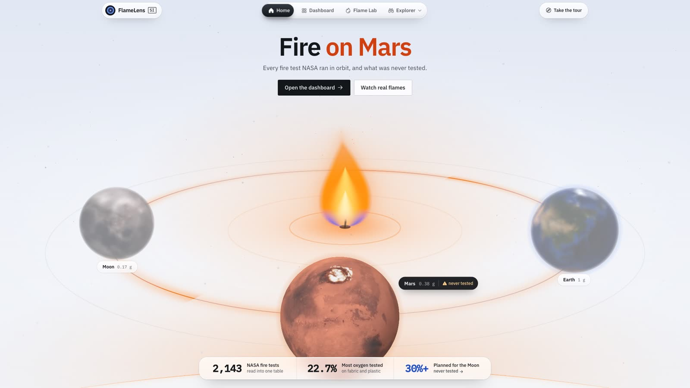

# FlameLens SI

FlameLens SI reads every itemized combustion test in NASA's Physical Sciences Informatics (PSI) archive into one table, traces each value to the file, row and column it came from, and shows what is known and what was never tested about fire in a crew cabin.

**Live: [flamelens.si](https://flamelens.si)**

[](https://flamelens.si)

Built for the NASA Space Apps Challenge 2026, "Flame in Freefall". It is an independent project, not affiliated with or endorsed by NASA.

**30-second demo: [flamelens.si/demo](https://flamelens.si/demo)**

## What is different about it

- **It plays NASA's own recording of the test.** 479 tests have a NASA video, streamed straight from NASA's storage, next to the curves NASA measured while the test burned (448,551 points) and 1,819 NASA photographs.
- **It reads NASA's reports as well as NASA's tables.** From the tables alone, 11 solid-fuel tests have oxygen, air speed and an outcome together. With NASA's reports and test sheets, 212 do, and each added value quotes NASA's own sentence.
- **It keeps NASA's original cell beside every value.** The highest oxygen for a solid in the archive, 22.7%, comes from a cell in NASA's BASS spreadsheet written as a formula: `=171.81/756.14`, oxygen pressure over total pressure.
- **It does not predict and it does not grade.** Where NASA has no test it says "not known" and names the nearest real test, instead of estimating a flame or scoring a cabin as safe.
- **The SI is boxed in.** It can only run four lookups over the table, and every number it writes is checked against what they returned.
- **Every check can be run again.** `pnpm check` runs the types, the lint and the tests of all three packages, and `uv run pytest` runs the pipeline's.

## What is in the product

Three features, each with its own job, and the SI inside every one of them.

| Feature | Route | Its job | NASA's ask |
|---|---|---|---|
| Dashboard | `/explore` | A question about one cabin. Describe the cabin, what might burn and where it is, then press Analyze. Five views (oxygen, air speed, pressure, gravity, experiments) show where the evidence runs out, and the SI says what it means. Each analysis is a block that can be copied or saved as CSV or JSON | Identify the most relevant investigations; SI that summarizes, ranks and interprets |
| Flame Lab | `/lab` | One test at a time. Three benches (plastic and fabric, fuel droplet, gas flame) that work the same way: choose what burns and the air around it, watch NASA's own video of the nearest real test, and read what was measured. 324 of its 812 tests come with NASA's video, played straight from the PSI archive | Data that supports predictive modelling |
| Explorer | `/investigations`, `/safety`, `/data` | The archive itself, in three views that share one bar and one SI: the 24 experiments in plain words (with a compare view at `/compare`), fire safety by prevention, detection and suppression (with Earth uses), and every test row to filter and download as CSV or JSON | Summarize, show similarities and differences; research that informs safety equipment; extract data |

The SI answers plain-language questions, typed or spoken, from the table with evidence cards and a number check. It also carries out requests such as "show me the rover for fabric". It has no page of its own: on the dashboard it is the panel that holds the analysis, in the Flame Lab it is a card beside the test, and in the Explorer it is the ask box in the bar.

The home page (`/`) opens on one flame at four gravities: NASA's 3D models of Earth, Mars, the Moon and the space station go round a flame drawn in code, which changes shape with each place's gravity. `/methods` documents limits, repairs and scoring.

Opening a test anywhere shows its record in place: NASA's photographs of the burn, the curves measured while it burned, NASA's own sentences about it, and every value with the file, row and column it came from.

## How it is built

```
web/        The site: Next.js pages and components. It holds no data; it reads everything from the API.
api/        The API: the Postgres schema and migrations, the queries, the export and the SI.
shared/     The rules both sides use: oxygen and airflow bands, scoring, filters, formats and their types.
pipeline/   Python. Downloads PSI records and tables, cleans them, writes data/curated/*.json
  flamelens_pipeline/dictionary/   The editable knowledge: one YAML file per kind of thing
data/       raw (snapshots as downloaded), staged, curated (what the API's database is loaded from), packs (evidence read from NASA's reports)
docs/data-pack/   The check every evidence pack must pass before the pipeline merges it
LICENSE     MIT, for the code. NASA's data, photographs, recordings and 3D models remain NASA's.
```

```
NASA PSI --> pipeline --> data/curated --> Postgres --> api --> web --> browser
                                                         |
                                   Amazon Bedrock (the SI's model), ElevenLabs (the voice)
```

- Only the API holds keys and talks to Postgres, Amazon Bedrock and ElevenLabs. The site holds none.
- The pages are prerendered from the API's reads and cached. In the browser, a request to `/api/*` on the site is passed on to the API, so the browser only ever talks to the site.
- `web` uses the code in `shared` and the types of `api`. It never runs the API's code, and `api` never imports from `web`.
- To give the pages a new read: write the query in `api/src/queries.ts`, name it in `READS` in `api/src/app.ts`, and add its function to `web/src/lib/data.ts`.

## Run it

Needs Node 20.11 or later, pnpm 10 and PostgreSQL 16. Rebuilding the data also needs Python 3.12 or later with uv.

```bash
pnpm install
createdb flamelens                    # once
cp api/.env.example api/.env          # DATABASE_URL, API_PORT, and the optional service keys
cp web/.env.example web/.env.local    # API_URL
pnpm db:setup                         # create the tables and load data/curated
pnpm dev                              # the API on :4000, the site on http://localhost:3000

pnpm check                            # types, lint and tests in every package
pnpm build && pnpm start              # the production build
```

To rebuild the data from the saved NASA snapshots:

```bash
cd pipeline
uv run python -m flamelens_pipeline --offline
uv run pytest
```

The site runs without any service key: the SI then serves prepared answers whose lookups still run live, and answers are read aloud by the browser's own voice.

## The API

| Address | What it returns |
|---|---|
| `GET /health` | `{ "ok": true }` |
| `GET /v1/<read>` | One of the reads the pages are built from: `investigations`, `clusters`, `coverage`, `explorer-rows` and the others listed in `api/src/app.ts` |
| `GET /v1/investigations/<id>` | One investigation with its publications, source tables and records |
| `GET /v1/investigations/<id>/variation` | How much each of its variables varied across its tests |
| `GET /v1/record?id=<record id>` | One test with every value, its raw PSI cell and where the value came from |
| `GET /v1/export?format=wide\|long\|json` | The records that match the filters, as CSV or JSON |
| `GET /v1/ask`, `POST /v1/ask` | Whether live answers are on; the answer to a question |
| `GET /v1/footage?id=<record id>&view=main\|second` | A short-lived link to NASA's own video of one test, in NASA's archive |
| `POST /v1/feedback` | Records that a visitor marked an analysis or an answer as not helpful |
| `POST /v1/speak` | An answer read aloud, as MP3 |

## When NASA changes something

Each kind of change touches one place.

| What changed | Where to edit | Then run |
|---|---|---|
| PSI published new or corrected tables | nothing | `uv run python -m flamelens_pipeline --refresh`, then `pnpm db:setup` |
| A new investigation appeared | add it to `dictionary/investigations.yaml`; map its table in `dictionary/tables.yaml` | pipeline, then `pnpm db:setup` |
| A column's meaning is defined in another NASA file (a ReadMe) | list the file in `dictionary/documents.yaml`; give the column `evidence` and `evidence_source: doc:<id>` in `dictionary/tables.yaml` | `uv run python -m flamelens_pipeline` (fetches the file), then `pnpm db:setup` |
| A folder of new values arrived from outside (an evidence pack) | put it in `data/packs/` (see the README there) | `uv run python -m flamelens_pipeline --offline`, then `pnpm db:setup` |
| A table gained a column | add the variable to `dictionary/variables.yaml` and the column to `dictionary/tables.yaml` | pipeline, then `pnpm db:setup` |
| A cabin atmosphere or scenario changed | `dictionary/reference.yaml` | pipeline, then `pnpm db:setup` |
| The briefing for a cabin should say something else | `dictionary/interpretations.yaml` | pipeline, then `pnpm db:setup` |
| A prepared SI answer needs new wording | `api/src/prepared-answers.ts` | nothing; the number check shows any figure that no longer matches |
| Add or remove a page | `web/src/app/<route>/page.tsx` and the `NAV` list in `web/src/components/site-header.tsx` | nothing |
| Add a bench to the Flame Lab | a spec in `shared/src/benches.ts` and a query in `getBenchRows` (`api/src/queries.ts`) | `pnpm test` |
| New generated pictures or clips were dropped in | nothing | `web/scripts/mark-generated.sh public/illustrations/*.jpg public/illustrations/motion/*.mp4` (stamps the SI-generated mark NASA requires; skips files already marked) |
| Add a material to the dashboard | `shared/src/materials.ts` | nothing |
| Change which variables count as a result | `RESULT_VARIABLES` in `api/src/queries.ts` | `pnpm build` |
| Change how experiments are ranked | `shared/src/scoring.ts` (covered by `scoring.test.ts`) | `pnpm test` |

The pipeline refuses to build if a quotation attributed to NASA is not found word for word in NASA's text, so an edit cannot quietly invent a source.

## The SI and the voice

Both are optional and are set in `api/.env`.

- **The model** is reached through Amazon Bedrock: `BEDROCK_API_KEY` and `BEDROCK_REGION`. The default is `openai.gpt-oss-120b`, with `moonshotai.kimi-k2.5` used if the account has no access to it; `BEDROCK_MODEL` takes any chat model Bedrock offers. The model can only call four lookup functions over this database (`api/src/si.ts`), and every figure in its answer is compared with what those lookups returned.
- **What never reaches the model:** the questions the site suggests, which have prepared answers whose lookups still run, and a question already answered for the same cabin in the last few hours.
- **Limits:** 12 questions and 20 readings per visitor per hour, a daily spend cap (`SI_DAILY_BUDGET_USD`) and a daily character cap for the voice (`VOICE_DAILY_CHARACTERS`). One model call may take a minute and a whole question a minute and a half. Past a limit or on any failure, the visitor gets a prepared answer or NASA's own text.
- **The voice** is ElevenLabs: `ELEVENLABS_API_KEY`. Without it the Listen button uses the voice built into the browser.

## SI use

- The code, the data pipeline and the site's text were written with an SI coding tool (Claude, Anthropic), working with the team.
- The one-line summaries, fire-safety levels and ratings of the investigations were written by an SI model after reading each PSI record. Each carries a quotation, and the pipeline stops if a quotation is not found word for word in NASA's text.
- Photographs and footage are NASA's. The line drawings, their animations and the two white models are concept illustrations made with image and video models (Higgsfield); each carries a visible "SI-generated" mark, and none contains a NASA logo, flag or mission badge.
- No value in the tables, the charts or the ranking was produced or estimated by a model. Each comes from a PSI table cell or from NASA's own text, through the code in this repository.

The same statement is on the site at `/methods`, in the page metadata and in the JSON export.

## Credits

- Data, photographs and video: NASA's Physical Sciences Informatics (PSI) repository, and the reports, test matrices and recordings NASA publishes with each investigation.
- 3D models on the home page: NASA. Earth and Mars from NASA Science 3D resources (NASA/JPL-Caltech), the Moon from NASA's Scientific Visualization Studio (Lunar Reconnaissance Orbiter data), the International Space Station from NASA's ISS model.
- Open-source software: Next.js, React, Tailwind CSS, three.js (the home page's scene), mpegts.js (NASA's downlink recordings), Drizzle, Postgres, and uv with pytest for the pipeline.
- SI tools and what each was used for are listed on `/methods`.

## Sources

NASA Physical Sciences Informatics (PSI), https://psi.nasa.gov: the investigation records and the experimental tables, released under CC0-1.0. Photographs and footage are NASA's and are credited where they appear. The challenge statement is quoted from the NASA Space Apps Challenge 2026.

## What this does not do

It reads NASA's experimental summary tables and record text, not the 12 TB of raw video and sensor files. It ranks relevance; it does not rate safety. Nothing in the archive was measured at Moon or Mars gravity, and the site says so wherever that matters.

## License

The code is released under the MIT License (see `LICENSE`). NASA's data, photographs, recordings and 3D models are NASA's and are used under NASA's media guidelines; the PSI records and tables are CC0-1.0.
